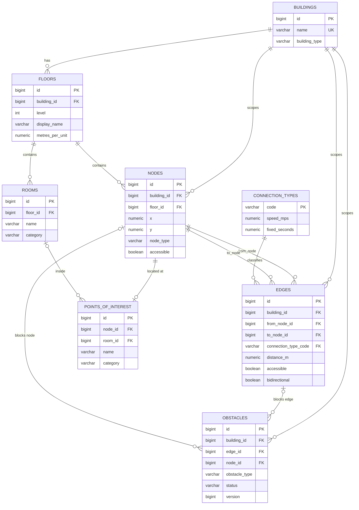

# DATABASE: Indoor Navigation and Path Optimization System

| Field | Value |
|---|---|
| Status | Draft v0.1, awaiting owner approval on flagged decisions |
| Depends on | PRD.md, ARCHITECTURE.md (this file refines ARCHITECTURE.md Section 7; Section 15 lists the small corrections) |
| Audience | Database/DevOps owner, backend owner, engine owner, AI coding agents |
| Scope | The relational schema, constraints, indexes, access model, migrations, seed data and backup approach. No application code is defined here. |

## 0. How to use this document

- This file is the source of truth for the schema. Flyway migrations implement it; if a migration and this document disagree, fix one of them in the same pull request.
- **[ASSUMPTION DBA-n]** marks something assumed. **[DECISION DBD-n]** marks a choice needing owner approval. Both are collected in Section 15. Agents follow the recommended default until a decision is made.
- The schema is **platform-neutral**. No table, column or constraint is mall-specific. Mall content exists only in seed data (Section 12).
- Only data the PRD requires is stored. Anything not listed here (users, sessions, route history, analytics, device preferences) is deliberately absent (Section 14).

---

## 1. Database technology

| Item | Choice | Reason |
|---|---|---|
| Engine | PostgreSQL, current stable major at project start (17 or later; DBA-1) | Mandated; relational integrity, partial and expression indexes, rich constraints |
| Access | Spring Data JPA over Hibernate, schema **validated** (never generated) | Mandated; Flyway is the only thing that changes the schema |
| Migrations | Flyway, versioned plus repeatable | Mandated; see Section 11 |
| Extensions | None in the MVP | Fewer moving parts. Trigram search is a Future option |
| Encoding and time | UTF-8; all timestamps stored as UTC timestamps with time zone | Unambiguous times across devices |
| Topology | One database, one schema (`public`), one backend instance | MVP scope (ARCHITECTURE.md Section 1) |

Compatibility rule: only standard PostgreSQL features available in version 16 and later are used, so the version can move without schema changes.

---

## 2. Conventions

| Topic | Rule |
|---|---|
| Names | `snake_case`; plural table names; `id` for primary keys; foreign keys named `<singular_table>_id` (or `from_node_id` and `to_node_id` where roles differ) |
| Constraint and index names | Prefixes `pk_`, `fk_`, `uq_`, `ck_`, `ix_` followed by table and columns, so errors are readable |
| Primary keys | 64-bit integers from identity columns declared **generated by default**, so seed data can use fixed IDs (DBD-11). IDs are stable across requests and restarts |
| Enumerated values | Fixed sets owned by the code (node type, obstacle type, obstacle status) are stored as text with a CHECK constraint, not as PostgreSQL enum types, because altering CHECK constraints is simpler than altering enums. The only extensible set, connection types, is a lookup table (DBD-5) |
| Money and measurements | Coordinates, distances and times use fixed-precision numeric types (no floating point in storage). Metres for distance, seconds for time, plan units for coordinates |
| Booleans | Always NOT NULL |
| Text | Trimmed, bounded lengths; no unbounded text columns |
| Timestamps | Only where the PRD needs them (obstacles). Static graph data has no audit columns |
| Deletes | Foreign keys use the default RESTRICT behaviour; there are no cascading deletes (DBD-9) |
| Schema | `public`; objects owned by the migration role (Section 8) |

---

## 3. Entity relationships

### 3.1 ER diagram

### 3.2 Relationship rules

| Relationship | Cardinality | Rule |
|---|---|---|
| Building to floors | 1 to many | A floor belongs to exactly one building; level and display name are unique within it |
| Floor to nodes | 1 to many | A node belongs to exactly one floor |
| Floor to rooms | 1 to many | A room belongs to exactly one floor |
| Node to edges | many to many through `edges` | An edge links two different nodes **of the same building**; nodes on different floors form the vertical connections |
| Connection type to edges | 1 to many | Every edge has a type |
| Node to point of interest | 1 to 0 or 1 | A POI is located at exactly one node, and a node hosts at most one POI |
| Room to point of interest | 1 to many, optional | A POI may belong to a room; the room must be on the node's floor (checked by test, Section 5.3) |
| Obstacle to edge or node | many to exactly one of the two | An obstacle targets one edge **or** one node, never both, never neither |
| Building to nodes, edges, obstacles | 1 to many | `building_id` is stored on these tables and guarded by composite foreign keys (DBD-1) |

---

## 4. Tables and columns

Notation: **PK** primary key, **FK** foreign key, **UQ** unique. "Default" blank means no default (a value is required on insert).

### 4.1 `buildings`

An indoor environment (PRD: building = environment, A-8).

| Column | Type | Null | Default | Notes |
|---|---|---|---|---|
| id | bigint | No | identity (by default) | PK |
| name | varchar(120) | No | | UQ; at least one non-space character |
| description | varchar(500) | Yes | | Short text shown on the building list |
| building_type | varchar(50) | No | | Free-text label such as "Shopping mall". **Display only; never used in logic** |
| address | varchar(255) | Yes | | Optional |

The coordinate scale from PRD Section 8.1 lives on `floors`, not here (DBD-6, DBA-3).

### 4.2 `floors`

| Column | Type | Null | Default | Notes |
|---|---|---|---|---|
| id | bigint | No | identity (by default) | PK |
| building_id | bigint | No | | FK to `buildings.id` |
| level | integer | No | | Ordering value: ground is 0, basements negative |
| display_name | varchar(40) | No | | Label shown in the app, such as "G" or "Floor 1" |
| plan_asset_path | varchar(255) | No | | Relative path of the SVG plan (Section 5.2 pattern) |
| plan_width | numeric(9,2) | No | | Plan units; greater than 0; equals the SVG width |
| plan_height | numeric(9,2) | No | | Plan units; greater than 0; equals the SVG height |
| metres_per_unit | numeric(9,6) | No | | Greater than 0; converts plan units to metres |

Keys: UQ (building_id, level); UQ (building_id, display_name); UQ (id, building_id) as the target for composite foreign keys.

### 4.3 `connection_types`

Lookup table that makes connection kinds data rather than code (PRD 8.1).

| Column | Type | Null | Default | Notes |
|---|---|---|---|---|
| code | varchar(30) | No | | PK; upper-case letters, digits and underscores |
| name | varchar(60) | No | | Display name |
| speed_mps | numeric(5,2) | No | | Travel speed in metres per second; greater than 0 |
| fixed_seconds | numeric(6,2) | No | 0 | Added once per traversal (for example elevator wait); 0 or more |

Reserved codes: **STAIRS** and **ELEVATOR** carry meaning in the routing preferences (AVOID_STAIRS, PREFER_ELEVATOR). Other codes (CORRIDOR, RAMP, DOORWAY, and any future type) behave generically through speed, fixed time and the edge's own accessibility flag. Surcharge factors are application configuration, not stored here.

### 4.4 `nodes`

| Column | Type | Null | Default | Notes |
|---|---|---|---|---|
| id | bigint | No | identity (by default) | PK |
| building_id | bigint | No | | Part of composite FK to `floors` (DBD-1) |
| floor_id | bigint | No | | Composite FK (floor_id, building_id) to `floors` (id, building_id) |
| x | numeric(9,2) | No | | Plan units; 0 or more |
| y | numeric(9,2) | No | | Plan units; 0 or more |
| node_type | varchar(30) | No | | CHECK: CORRIDOR_JUNCTION, ROOM_ENTRANCE, STAIR_LANDING, ELEVATOR_ENTRANCE, BUILDING_ENTRANCE, FLOOR_TRANSITION, POINT_OF_INTEREST |
| display_name | varchar(120) | Yes | | Present for named nodes (entrances, transitions) |
| accessible | boolean | No | true | False for nodes unsuitable for step-free routing, such as stair landings |

Keys: UQ (floor_id, x, y), which prevents accidental duplicate nodes; UQ (id, building_id) as the target for composite foreign keys.

### 4.5 `edges`

One row per physical connection. A bidirectional edge is **one row**; the loader expands it into both directions.

| Column | Type | Null | Default | Notes |
|---|---|---|---|---|
| id | bigint | No | identity (by default) | PK |
| building_id | bigint | No | | Part of both composite FKs below |
| from_node_id | bigint | No | | Composite FK (from_node_id, building_id) to `nodes` (id, building_id) |
| to_node_id | bigint | No | | Composite FK (to_node_id, building_id) to `nodes` (id, building_id) |
| connection_type_code | varchar(30) | No | | FK to `connection_types.code` |
| distance_m | numeric(8,2) | No | | Greater than 0. **Stored explicitly for every edge**, including vertical ones (DBD-6) |
| time_seconds | numeric(8,2) | Yes | | Optional explicit override, greater than 0; when null, time is derived from the type's speed and fixed time |
| accessible | boolean | No | | Required, no default: the author must decide. False for stairs |
| bidirectional | boolean | No | true | PRD A-5 |

Keys and rules: UQ (id, building_id); CHECK from_node_id differs from to_node_id; a unique index over the **unordered node pair and type** so the same connection cannot be entered twice in opposite directions (Section 6).

### 4.6 `rooms`

Named spaces drawn on the floor plan; used for labels and the room listing endpoint.

| Column | Type | Null | Default | Notes |
|---|---|---|---|---|
| id | bigint | No | identity (by default) | PK |
| floor_id | bigint | No | | FK to `floors.id` |
| name | varchar(120) | No | | UQ with floor_id |
| category | varchar(50) | No | | Lower-case slug (Section 5.2) |
| description | varchar(500) | Yes | | Optional |
| bounds_x | numeric(9,2) | No | | Left edge in plan units; 0 or more |
| bounds_y | numeric(9,2) | No | | Top edge in plan units; 0 or more |
| bounds_width | numeric(9,2) | No | | Greater than 0 |
| bounds_height | numeric(9,2) | No | | Greater than 0 |

Rectangular bounds give the app what DESIGN.md Section 7.5 needs (label position, whether the space is large enough for its name, tap region) without storing polygon geometry, which stays in the SVG (DBD-7, DBA-4).

### 4.7 `points_of_interest`

Searchable destinations. Position and floor come from the linked node and are **not duplicated** here.

| Column | Type | Null | Default | Notes |
|---|---|---|---|---|
| id | bigint | No | identity (by default) | PK |
| node_id | bigint | No | | FK to `nodes.id`; **UQ**: one POI per node, exactly one node per POI |
| room_id | bigint | Yes | | FK to `rooms.id` |
| name | varchar(120) | No | | Searched by the app; not unique (two restrooms may share a name; the floor distinguishes them) |
| category | varchar(50) | No | | Lower-case slug (Section 5.2) |

### 4.8 `obstacles`

The only table the running application writes to.

| Column | Type | Null | Default | Notes |
|---|---|---|---|---|
| id | bigint | No | identity (by default) | PK |
| building_id | bigint | No | | Part of both composite FKs below |
| edge_id | bigint | Yes | | Composite FK (edge_id, building_id) to `edges` (id, building_id) |
| node_id | bigint | Yes | | Composite FK (node_id, building_id) to `nodes` (id, building_id) |
| obstacle_type | varchar(30) | No | | CHECK: BLOCKED_CORRIDOR, CLOSED_ROOM, BROKEN_ELEVATOR, CLOSED_STAIRCASE, CONSTRUCTION_AREA, RESTRICTED_CONNECTION |
| description | varchar(200) | No | | Visitor-facing text; 3 to 200 characters after trimming (DBD-8) |
| status | varchar(10) | No | 'ACTIVE' | CHECK: ACTIVE, RESOLVED |
| created_at | timestamptz | No | now() | UTC |
| updated_at | timestamptz | No | now() | Set by the application on every update |
| version | bigint | No | 0 | Optimistic-locking counter (ARCHITECTURE.md 6.6) |

Rules: CHECK that **exactly one** of edge_id and node_id is present (AD-11); at most one ACTIVE obstacle per target (partial unique indexes, Section 6). RESOLVED rows are kept as history until deleted by an administrator.

### 4.9 Tables not defined here

`flyway_schema_history` is created and owned by Flyway. There is **no users table**: the single administrator is configured through the environment (PRD A-3, A-4; ARCHITECTURE.md Section 11).

---

## 5. Constraints and validation

### 5.1 Where each rule is enforced

| Rule | Database | Backend service or DTO | Test |
|---|---|---|---|
| Required fields, lengths, types | Yes (NOT NULL, varchar limits) | Yes (bean validation, for good error messages) | |
| Positive distances, speeds, dimensions | Yes (CHECK) | Yes | |
| Fixed value sets (node type, obstacle type, status) | Yes (CHECK) | Yes (enums) | |
| Obstacle has exactly one target | Yes (CHECK) | Yes | |
| Edge nodes are in the same building | Yes (composite FKs) | | |
| Node's floor belongs to the node's building | Yes (composite FK) | | |
| Obstacle target belongs to the obstacle's building | Yes (composite FKs) | Derives building from the target | |
| One active obstacle per target | Yes (partial unique indexes) | Returns conflict with a clear message | |
| Concurrent obstacle edits | Version column | Optimistic-lock conflict (HTTP 409) | |
| Obstacle type fits its target (for example BROKEN_ELEVATOR on an elevator connection or node) | | Yes | |
| Route start and destination exist and share a building | | Yes | |
| Edge distance is at least the straight-line horizontal distance between its nodes (A* admissibility) | | | Seed and data-integrity test |
| Node coordinates lie inside the floor's plan width and height | | | Data-integrity test |
| Room named by a POI is on the same floor as the POI's node | | | Data-integrity test |
| Vertical connection (nodes on different floors) uses a type that makes sense and has an explicit distance | | | Data-integrity test |

Rules that need joins across tables are checked by tests because graph data changes only through reviewed migrations (Section 8). If an in-app graph editor is ever added, these become service rules and, where worthwhile, constraint triggers (Future).

### 5.2 Format rules

| Field | Rule |
|---|---|
| `category` (rooms and POIs) | Lower-case slug: letters, digits and hyphens, starting with a letter. The app maps known slugs to icons and falls back to a generic icon for unknown ones, so new categories need no code (DESIGN.md Section 5.5) |
| `plan_asset_path` | Relative path, lower-case letters, digits, hyphens, underscores and slashes, ending in `.svg`; no leading slash and no parent-directory segments. This stops path traversal where the backend serves the files |
| `connection_types.code` | Upper-case letters, digits, underscore |
| Descriptions and names | Not blank after trimming |

### 5.3 Data-integrity test suite

Owned by Person 4, run in CI against the seeded database (ARCHITECTURE.md 7.6). It verifies every "Test" row above, that every demonstration scenario in Section 12.2 behaves as specified, and that the whole migration chain applies to an empty database and passes Hibernate's schema validation.

---

## 6. Queries and indexes

Indexes exist only for queries the product actually issues. PostgreSQL does not index foreign keys automatically, so each FK is listed as indexed or deliberately left unindexed.

### 6.1 Query catalogue

| # | Journey and query | Frequency | Served by |
|---|---|---|---|
| Q1 | List buildings (J1) | Each app start | Table is tiny; sequential scan |
| Q2 | Floors of a building in level order (J1) | Each building open | UQ (building_id, level) |
| Q3 | Floor map: nodes of a floor | Each floor view | `ix_nodes_floor` |
| Q4 | Floor map: connections touching a floor's nodes (including vertical ones) | Each floor view | `ix_edges_from_node`, `ix_edges_to_node` |
| Q5 | Floor map: rooms of a floor | Each floor view | `ix_rooms_floor` |
| Q6 | Floor map: POIs of a floor (join to nodes) | Each floor view | UQ on POI node_id, `ix_nodes_floor` |
| Q7 | Floor map: active obstacles for blocked flags (join through edges or nodes) | Each floor view | `ix_obstacles_building_status` |
| Q8 | **Route:** load all nodes of a building | **Every route request** | `ix_nodes_building` |
| Q9 | **Route:** load all edges of a building | **Every route request** | `ix_edges_building` |
| Q10 | **Route:** load connection types | Every route request | Table is tiny |
| Q11 | **Route:** active obstacles of a building | **Every route request** | `ix_obstacles_building_status` |
| Q12 | Route validation: both nodes exist and share a building | Every route request | Primary key lookups; `building_id` is on the node |
| Q13 | Destination search by building, text and category, with a limit (J1) | Per typed query | `ix_nodes_building` through the POI-to-node join; text match scans the building's few hundred POIs |
| Q14 | Category list for a building | Per search screen | Same join as Q13 |
| Q15 | Selectable start nodes of a building (named nodes) | Per start selection | `ix_nodes_building` |
| Q16 | Admin: obstacles by building and status (J4) | Per admin screen | `ix_obstacles_building_status` |
| Q17 | Admin: create, update, delete one obstacle | Rare | Primary key; partial unique indexes |

### 6.2 Index list

| Index | Table and columns | Type | Purpose |
|---|---|---|---|
| (primary keys) | Every table | Unique | Lookups, joins |
| `uq_buildings_name` | buildings (name) | Unique | No duplicate names |
| `uq_floors_building_level` | floors (building_id, level) | Unique | Q2; ordering; integrity |
| `uq_floors_building_display_name` | floors (building_id, display_name) | Unique | Integrity |
| `uq_floors_id_building` | floors (id, building_id) | Unique | Composite FK target |
| `uq_nodes_id_building` | nodes (id, building_id) | Unique | Composite FK target |
| `uq_nodes_floor_position` | nodes (floor_id, x, y) | Unique | No duplicate nodes |
| `ix_nodes_floor` | nodes (floor_id) | B-tree | Q3, Q6 |
| `ix_nodes_building` | nodes (building_id) | B-tree | Q8, Q13, Q14, Q15 |
| `uq_edges_id_building` | edges (id, building_id) | Unique | Composite FK target |
| `ix_edges_from_node` | edges (from_node_id) | B-tree | Q4 |
| `ix_edges_to_node` | edges (to_node_id) | B-tree | Q4 |
| `ix_edges_building` | edges (building_id) | B-tree | Q9 |
| `uq_edges_node_pair_type` | edges (least of the two node IDs, greatest of the two node IDs, connection_type_code) | Unique, expression | Prevents duplicate connections entered in opposite directions |
| `uq_rooms_floor_name` | rooms (floor_id, name) | Unique | Integrity; serves Q5 |
| `uq_poi_node` | points_of_interest (node_id) | Unique | One POI per node; Q6 |
| `ix_obstacles_building_status` | obstacles (building_id, status) | B-tree | Q7, Q11, Q16 |
| `uq_obstacles_active_edge` | obstacles (edge_id) where status is ACTIVE and edge_id is not null | Unique, partial | One active obstacle per edge |
| `uq_obstacles_active_node` | obstacles (node_id) where status is ACTIVE and node_id is not null | Unique, partial | One active obstacle per node |

### 6.3 Deliberately not indexed

| Candidate | Why not |
|---|---|
| `points_of_interest (lower(name))` | The search is a "contains" match, which a standard B-tree cannot use. ARCHITECTURE.md Section 7.3 mentions such an index; this document supersedes it (Section 15). Revisit with trigram search when a building has thousands of POIs |
| `edges (connection_type_code)` | Lookup has a handful of values; no query filters on it |
| `points_of_interest (room_id)` | No query filters by room |
| `obstacles (edge_id)` and `(node_id)` for non-active rows | Only needed when a migration deletes graph rows, which is rare and small |
| Any covering or partial index beyond the above | Premature at about 2,000 nodes per building (PRD A-2) |

### 6.4 Capacity assumption

DBA-2: one building has up to about 2,000 nodes, about 6,000 edges, a few hundred POIs and rooms, and up to a few hundred obstacle rows ever. Total storage is a few megabytes per building. No partitioning, no pooling beyond the framework default.

---

## 7. Journey coverage

| PRD journey | Data it needs | Where it lives |
|---|---|---|
| J1 Navigate | Buildings, floors, POIs, nodes, edges, connection types, plan assets, active obstacles | All graph tables plus `obstacles` |
| J2 Accessible navigation | Accessibility flags on nodes and edges | `nodes.accessible`, `edges.accessible` |
| J3 Blocked route | Active obstacles reflected in routing and on the map | `obstacles` read at request time |
| J4 Administrator manages obstacles | Create, edit, resolve, delete; persistence across restarts | `obstacles` |
| J5 Onboard a new environment | Insert a building and its graph as data only | Migrations and seed-style scripts; no schema change |

---

## 8. Ownership and authorization

### 8.1 Who may change what

| Data | Runtime application | Visitors (through the API) | Administrator (through the API) | Schema owner (migrations) |
|---|---|---|---|---|
| `buildings`, `floors`, `connection_types`, `nodes`, `edges`, `rooms`, `points_of_interest` | **Read only** | Read through public endpoints | Read; **no write** (PRD FR-39) | Create, change, delete |
| `obstacles` | Read and write | Read through map and route responses only (blocked flag, type, description) | Create, update, resolve, delete | Rare data fixes |
| `flyway_schema_history` | None | None | None | Flyway only |

Authorization decisions are made by the **backend** (ARCHITECTURE.md Section 11). The database does not know about end users.

### 8.2 Database roles

| Role | Used by | Privileges | Notes |
|---|---|---|---|
| `indoornav_owner` | Flyway migrations; owns all objects | Full DDL and DML on the schema | Used only at migration time in hosted environments |
| `indoornav_app` | The running backend | SELECT on all tables; INSERT, UPDATE and DELETE on `obstacles` only; USAGE on its sequence | No DDL, no superuser, cannot alter graph data |

Effect: even a compromised API cannot rewrite the building graph, only the obstacle table. Hosted environments use both roles, with Flyway configured with the owner credentials and the application datasource with the app credentials (DBD-3). In local development a single role may be used for simplicity. Using two sets of credentials adds optional variables to ARCHITECTURE.md Section 15.2 (Section 15).

### 8.3 Data stewardship

| Concern | Owner | Consulted |
|---|---|---|
| Schema, migrations, seed data, integrity tests, database roles | Person 4 | Person 2 (entities), Person 3 (graph fields) |
| JPA entities and repositories matching this schema | Person 2 | Person 4 |
| Engine-facing graph mapping and invariants (distance versus straight line, costs positive) | Person 3 | Person 4 |
| Floor-plan SVG files and their dimensions matching `floors` | Person 4 | Person 1 (rendering) |

A schema change is a pull request that includes the migration, an update to this document, and updates to entities and tests. Cross-module changes need a reviewer from each affected domain (ARCHITECTURE.md Section 4).

### 8.4 Tenancy

There is no per-user ownership and no multi-tenancy in the MVP: all buildings are visible to everyone and the single administrator manages all obstacles. `building_id` on `obstacles` already allows per-building permissions later without restructuring (Section 14).

---

## 9. Row-level security

**Not used in the MVP.** Reasons:

- There are no per-user rows. Visitors are anonymous and read the same public data; there is one administrator role.
- All access goes through one backend using one database role; per-request database identities would add complexity without a requirement.
- The meaningful protection (graph data is read-only at runtime) is achieved more simply with table privileges (Section 8.2).

**Revisit when** multiple administrators with per-building permissions, or several operators sharing one database, are introduced. At that point policies would key off `building_id` (already present on `obstacles`, `nodes` and `edges`) and an administrator-to-building mapping table. Nothing in the current schema blocks that (DBD-4).

---

## 10. Sensitive-data handling

### 10.1 Classification

| Class | Data | Where | Handling |
|---|---|---|---|
| Public | Buildings, floors, nodes, edges, rooms, POIs, plan files | Database, repository | Served openly by public endpoints |
| Public once created | Obstacle type and **description**; blocked status | `obstacles` | Appears in visitor map and route responses. The admin form states this, and descriptions must not contain staff names, security details or personal data (guidance in API.md; the database cannot enforce it) |
| Secret | Administrator password hash, token-signing secret, database passwords | **Never in the database**; environment variables or the platform secret store | Not logged; not committed |
| Personal data | None | Not stored | Visitors are anonymous; no accounts, device IDs, locations or route history (PRD NFR-07, 8.4) |

### 10.2 Controls

- No personal data means no personal-data retention, export or deletion processes are needed in the MVP.
- The database is reachable only from the backend network; its port is not published outside local development.
- Hosted connections use TLS. The application uses the least-privileged role (Section 8.2), never a superuser.
- Persisted data is protected at rest by the host's volume or managed-database encryption; no column-level encryption is needed because no column holds secrets or personal data.
- SQL statement logging with bound parameter values is off outside development.
- Obstacles record **when** they changed but not **who**, because there is one shared administrator account. An actor column is added when multiple admin accounts are introduced (Future).
- Backups inherit the same classification (Section 13): no personal data, but still access-restricted.

---

## 11. Migration strategy

### 11.1 Layout and rules

| Item | Rule |
|---|---|
| Location | `database/migrations` is the source of truth; the backend build packages it so Flyway finds it on the classpath (ARCHITECTURE.md AD-6) |
| Versioned migrations | `V<number>__<description>`: one logical change each; **never edited after merging to main** |
| Repeatable migrations | `R__<description>`: used only for seed data (Section 12) |
| Direction | Forward-only. Flyway Community has no undo; mistakes are fixed by a new migration |
| Destructive changes | Use expand-and-contract: add the new structure, move data, release, then remove the old structure in a later migration |
| Review | A migration pull request is reviewed by the schema owner and the entity owner |
| Hibernate | Schema validation on startup; a mismatch fails the application at boot |

### 11.2 Initial migration sequence

| Order | Content |
|---|---|
| V1 | Tables `buildings`, `floors`, `connection_types` with constraints |
| V2 | Tables `nodes`, `edges`, `rooms`, `points_of_interest` with constraints and indexes |
| V3 | Table `obstacles` with constraints and indexes |
| V4 | Reference data every environment needs: the connection type rows (CORRIDOR, DOORWAY, RAMP, STAIRS, ELEVATOR) with default speeds and fixed times (DBA-5) |
| V5 | Database roles and grants for hosted environments, guarded so it is a no-op in local development (DBD-3) |

Connection types are reference data, not demo data, so they are in a versioned migration and always present.

### 11.3 Execution

- Flyway runs on backend startup; with one instance (DBA-6) this is safe. A multi-instance deployment would move migration to a separate pre-deploy step (Future).
- CI applies the full chain to an empty Testcontainers database and runs the integrity suite on every pull request.
- Before applying migrations to any hosted database, take a backup (Section 13).
- Flyway is configured to ignore **missing** repeatable seed migrations, so a database seeded earlier can run with seeding disabled.

---

## 12. Seed strategy

### 12.1 Mechanics

- Demo data (the sample mall) lives in `database/seed` as **repeatable migrations**, loaded only when `SEED_DEMO_DATA` is enabled (ARCHITECTURE.md 7.5).
- Repeatable migrations always run after all versioned ones, so adding a later schema migration never causes ordering problems (DBD-2).
- Seed scripts are **idempotent**: they insert rows with fixed IDs and update them if they already exist, so re-running is safe.
- **ID convention (DBD-11):** seed rows use fixed IDs below 10,000 in readable ranges per entity (so Postman collections, tests and docs have stable references); identity sequences start at 10,000, so runtime inserts never collide.
- The seed contains **no active obstacles**, so every demo starts with all routes open. Obstacles are created live during the demonstration.
- Production-style installations load schema and reference data only.
- Floor-plan SVGs live in `database/floorplans` and their dimensions match `floors.plan_width` and `plan_height`.

### 12.2 Sample dataset requirements (mall)

One building, **three floors** (PRD A-9 / D-5), with the following structure. Exact counts are indicative; the scenarios are mandatory.

| Content | Indicative size |
|---|---|
| Nodes | 60 to 90 |
| Edges | 80 to 130 |
| Rooms | 20 to 35 |
| POIs | 25 to 40, spread across floors, including restrooms and an information desk |
| Entrances | Several on the ground floor |
| Vertical connections | At least: a staircase and an elevator between floors 1 and 2; an elevator and a staircase between floors 2 and 3; optionally a ramp |

| Scenario (PRD 8.3) | Structural requirement in the data |
|---|---|
| S1 Blocked edge forces a detour | Two distinct corridor routes between the same pair of areas on one floor, so blocking one produces a longer alternative |
| S2 Shortest differs from fastest | At least one destination pair where the shorter path uses stairs and the faster path uses an elevator (speeds and fixed times tuned in V4 and the seed so this holds) |
| S3 Accessible differs from shortest | At least one pair where the shortest path uses stairs and the ACCESSIBLE path uses the elevator or ramp; stairs edges are flagged not accessible |
| S4 Broken elevator | The only accessible connection between floors 2 and 3 is one elevator edge, with stairs also available, so blocking it makes ACCESSIBLE routes to floor 3 return no route while SHORTEST still succeeds via stairs |
| S5 Unreachable destination | At least one destination reachable only through a single connection or entrance node, so blocking it isolates the destination |

All names, categories and labels in the seed are data; no core table, code or API contains mall concepts. A second small environment (PRD success criterion 13) is added as another repeatable seed script with no schema change.

---

## 13. Backup and recovery

### 13.1 What actually needs protecting

| Data | Reproducible? | Backup need |
|---|---|---|
| Schema and reference data | Yes, from migrations in Git | None beyond the repository |
| Demo graph data | Yes, from seed scripts in Git | None |
| Floor-plan SVGs | Yes, from Git | None |
| **Obstacles** | **No**, created at runtime | **Yes** |
| Any hosted-only graph data loaded outside Git | No | Only if such data exists; avoided by policy |

The only irreplaceable runtime data is the small `obstacles` table, so the backup design stays simple.

### 13.2 Strategy by environment

| Environment | Strategy |
|---|---|
| Local development and CI | No backups. Reset by recreating the volume; migrations and seed rebuild everything. Compose uses a **named volume**, and removing volumes deletes the data |
| Hosted demo or production-style | Nightly logical backup of the whole database to storage separate from the database host, 14 daily copies retained (DBA-7); plus an on-demand backup **before every migration or release**. A managed PostgreSQL service with point-in-time recovery is preferred when available and replaces the nightly dump |
| Security of backups | Encrypted at rest, restricted access, never committed to Git, same classification as the database |

### 13.3 Recovery

| Scenario | Procedure |
|---|---|
| Database lost or corrupted | Create a new database, run migrations (and seed if appropriate), restore the latest backup (or restore it directly, which includes the schema history), start the backend |
| Bad migration | Restore the pre-migration backup, correct the migration in a new version, redeploy; do not edit an applied migration |
| Obstacle data lost, backup unavailable | Rebuild from migrations and seed, then administrators re-enter active obstacles; acceptable at this scale (PRD FR-35, manual obstacles) |
| Accidental obstacle deletion | Re-create it (RESOLVED history helps, since resolving rather than deleting is the normal path) or restore from backup |

### 13.4 Targets and verification

- **Recovery point:** up to 24 hours of obstacle changes may be lost (DBA-7); the data is small and re-enterable.
- **Recovery time:** about one hour for a hosted demo (DBA-7).
- A **restore drill** is performed once before the final demonstration and after any backup tooling change: restore into a scratch database, start the backend against it, and confirm the integrity suite passes. An untested backup is not counted as a backup.

---

## 14. Not stored (and why), and Future data

### 14.1 Deliberately absent

| Data | Reason |
|---|---|
| Users, passwords, sessions, tokens | One configured administrator; stateless token (PRD A-3, A-4) |
| Route history, analytics, location | Out of scope and privacy-negative (PRD 8.4, NFR-07) |
| Visitor preferences | Device-local only (PRD FR-36) |
| Categories table | Slug text suffices; no category metadata is required |
| Floor-plan geometry (polygons) | Lives in the SVG; the database stores only plan size, scale and room bounds |
| Computed routes or cached graphs | Routes are computed per request; no stale data (PRD FR-32) |
| Audit log tables | Timestamps on obstacles are enough with one shared admin |

### 14.2 Future data additions (not built now)

| Future capability | Likely schema addition |
|---|---|
| Multiple administrators and per-building roles | `admin_users`, `admin_building_roles`; actor column on obstacles; row-level security policies |
| Scheduled obstacles | `starts_at` and `ends_at` on obstacles |
| QR start points | `qr_code` value on nodes or a small `start_points` table |
| Admin graph editor | Service-level and trigger-level cross-table validation; audit table |
| Faster text search | `pg_trgm` extension with a trigram index on POI names |
| Campus with several buildings | Inter-building connection concept |
| Per-building routing parameters | Columns or a table overriding connection type speeds |
| Route history | A separate table with an explicit retention policy and privacy review |

---

## 15. Assumptions, decisions and document corrections

### Assumptions

| ID | Assumption |
|---|---|
| DBA-1 | PostgreSQL 17 or later is available locally and in CI (matches ARCHITECTURE.md AA-2); confirm when setting up Compose |
| DBA-2 | Capacity per building: about 2,000 nodes, 6,000 edges, a few hundred POIs, rooms and obstacles (PRD A-2) |
| DBA-3 | All floors of a building share one aligned coordinate frame and differ only in scale per floor (ARCHITECTURE.md AA-3) |
| DBA-4 | Rectangular bounds are enough to place and size room labels; polygon geometry stays in the SVG |
| DBA-5 | Default connection type values to start from and tune against the sample data: walking speed 1.2 m/s for corridors and doorways, ramps slightly slower, stairs slower than walking, elevators with a fixed wait-plus-ride time (PRD A-6) |
| DBA-6 | One backend instance runs migrations at startup (ARCHITECTURE.md AA-1) |
| DBA-7 | Acceptable recovery point is 24 hours and recovery time one hour for a hosted demo |
| DBA-8 | Obstacle descriptions are visitor-facing text written by the administrator |

### Decisions requiring approval

| ID | Decision | Options | Recommended default |
|---|---|---|---|
| **DBD-1** | Same-building integrity | (a) Store `building_id` on `nodes`, `edges` and `obstacles`, guarded by composite foreign keys so it can never disagree with the floor; (b) derive the building through joins and verify with tests only | **(a).** The repeated column is protected by the database, makes the per-request graph load and route validation single-table queries, and keeps the later per-building permissions simple. The cost is one extra column on three tables |
| **DBD-2** | Seed mechanism | Repeatable migrations with idempotent upserts and fixed IDs; versioned migrations in a high version range | Repeatable migrations, which avoid Flyway out-of-order problems when later schema versions are added |
| **DBD-3** | Runtime database privileges | Two roles (owner for migrations, app role limited to writing obstacles) in hosted environments; one role everywhere | Two roles when hosted; one role locally for simplicity. Requires optional migration credentials in configuration |
| **DBD-4** | Row-level security | Not in the MVP; enable now | Not in the MVP (Section 9) |
| **DBD-5** | Enumerations | CHECK constraints for fixed sets, lookup table for connection types; PostgreSQL enum types for all; lookup tables for all | As stated: CHECK for fixed sets, lookup table only where data must extend |
| **DBD-6** | Distance and connection type columns | Explicit `distance_m` on every edge; drop `is_vertical` and default-accessibility from `connection_types`; scale on floors only | As stated. Vertical-ness is derivable from the endpoint floors, accessibility is stored on each edge, and scale is per floor. This refines ARCHITECTURE.md 7.2 and PRD 8.1 |
| **DBD-7** | Rooms and categories | Rectangular bounds on rooms; category as lower-case slug text; separate `categories` table | Bounds plus slug text. No categories table until categories need their own attributes |
| **DBD-8** | Obstacle description | Required (3 to 200 characters); optional | Required, giving visitors specific warnings. Resolves the open point in DESIGN.md Section 10.3 |
| **DBD-9** | Delete behaviour | Restrict everywhere; cascade from graph rows to obstacles | Restrict. A migration that removes a connection must handle its obstacles deliberately |
| **DBD-10** | Seed obstacles | None; include a sample resolved obstacle | None, so each demo starts clean |
| **DBD-11** | ID strategy | Identity "by default" with seed IDs below 10,000 and sequences starting at 10,000; identity "always" with lookups in seeds | As stated, for stable fixtures in tests, Postman and documentation |

### Corrections to other documents when this is approved

| Document | Section | Change |
|---|---|---|
| ARCHITECTURE.md | 7.2 | `connection_types` holds speed and fixed time only (no default accessibility, no vertical flag); `points_of_interest` has no floor column (floor comes from the node); `building_id` is also stored on nodes, edges and obstacles |
| ARCHITECTURE.md | 7.3 | Remove the lower-cased POI name index (Section 6.3 here); add the indexes listed in Section 6.2 |
| ARCHITECTURE.md | 15.2 | Add optional `MIGRATION_DB_USER` and `MIGRATION_DB_PASSWORD` (default to the application credentials) |
| PRD.md | 8.1 | Coordinate scale is stored per floor, not on the building; POI floor is derived from its node |
| DESIGN.md | 10.3 | Obstacle description is required, 3 to 200 characters |
