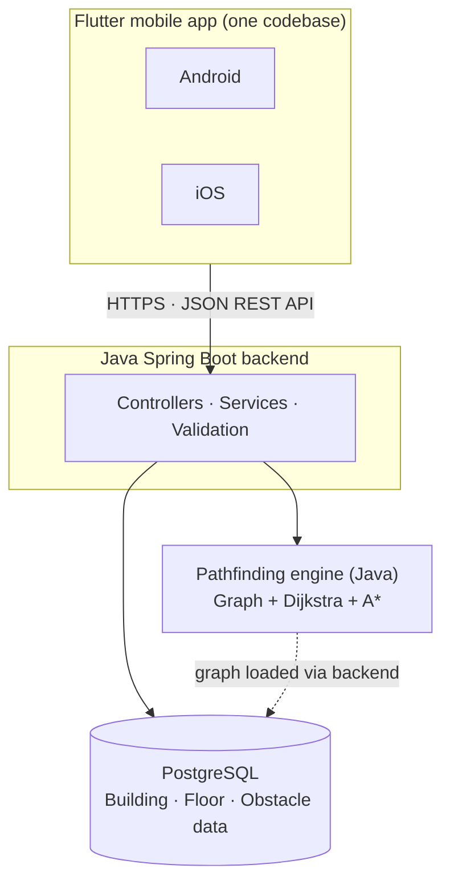

# ARCHITECTURE.md — Indoor Navigation System

> **Purpose:** This is the single source of truth for how the system is structured. Every team member and every AI coding agent must read this file before writing code. If a change affects module boundaries, the API contract or the database schema, update this file (and `API.md` / `DATABASE.md`) in the same pull request.

---

## 1. Overview

An indoor navigation system that lets users search for rooms inside a building, view floor maps, and get a route from one point to another, including across floors and with accessibility constraints.

**Key design decision:** one cross-platform mobile app (Flutter) talks to one Java backend over a REST API. The backend does not know or care whether a request came from Android or iOS.

### Goals

- One mobile codebase for Android and iOS.
- Java backend with a standalone, testable pathfinding engine.
- Four parallel workstreams that integrate through agreed contracts, not through shared code.
- Reproducible setup (Docker) and automated checks (GitHub Actions).

### Non-goals (for now)

- Separate native Android/iOS apps.
- Real-time positioning (BLE/Wi-Fi/UWB). The user selects their start location manually unless added later.
- A web frontend.

---

## 2. Tech Stack

| Layer | Technology | Responsibility |
| --- | --- | --- |
| Mobile app | Flutter + Dart, Material 3 | Indoor map, route display, search, navigation UI |
| Backend | Java 21 + Spring Boot | REST APIs, business logic, route requests, obstacle management |
| Pathfinding engine | Java (standalone module) | Graph structures, Dijkstra, A\*, multi-floor routing, accessibility constraints |
| Database | PostgreSQL | Buildings, floors, rooms, graph nodes/edges, obstacles |
| Dev & integration | GitHub, Docker, GitHub Actions | Shared repo, consistent environments, CI/CD |

---

## 3. System Architecture



### Request flow: computing a route

1. User picks a start and destination in the Flutter app.
2. App sends `POST /api/v1/routes` to the backend.
3. Backend validates the request, loads the relevant graph (nodes, edges, active obstacles) from PostgreSQL.
4. Backend passes the graph and constraints to the pathfinding engine.
5. Engine returns an ordered list of nodes (with floor changes marked) plus distance/time.
6. Backend maps the result to the API response format and returns it.
7. App renders the route on the floor map and shows step-by-step directions.

---

## 4. Repository Structure

One GitHub repository (monorepo):

```
indoor-navigation/
├── mobile-app/             # Person 1: Flutter
├── backend/                # Person 2: Spring Boot
├── algorithm-engine/       # Person 3: Java pathfinding library
├── database/               # Person 4: schema, migrations, seed data
├── docs/
│   ├── ARCHITECTURE.md
│   ├── API.md
│   └── DATABASE.md
└── docker-compose.yml
```

> If this file lives at the repo root instead of `docs/`, keep a pointer from `docs/` so both locations stay consistent.

---

## 5. Team Ownership

| Person | Domain | Stack | Owns |
| --- | --- | --- | --- |
| 1 | Cross-platform mobile frontend | Flutter · Dart · Material 3 | All screens, indoor map rendering, floor switching, room search, route display, mobile navigation; layout testing on Android and iOS |
| 2 | Java backend | Java 21 · Spring Boot · REST | Controllers, services, request validation, API responses, authentication (if required), integration with database and routing engine |
| 3 | Pathfinding engine | Java · Graphs · Dijkstra · A\* | Graph structures, shortest-path algorithms, multi-floor routing, accessibility constraints, route optimization |
| 4 | Database, DevOps, testing | PostgreSQL · Docker · GitHub Actions | Schema and sample data, migrations, environment setup, test infrastructure, deployment, integration testing coordination |

**Rule:** work inside your assigned module. Changes that cross a module boundary (API shape, schema, engine interface) must be agreed first and documented.

---

## 6. Components

### 6.1 Mobile app (`mobile-app/`)

**Responsibilities:** floor map display, room search, route display, navigation UI.

| Purpose | Choice |
| --- | --- |
| UI | Flutter + Material 3 |
| API calls | Dio |
| State management | Riverpod |
| Screen navigation | GoRouter |
| Indoor floor map | `CustomPainter` or `flutter_svg` |
| Local storage | SharedPreferences (SQLite if needed) |
| Data models | Freezed / JSON serialization (optional) |
| Testing | `flutter_test` + `integration_test` |

Start small: Flutter, Dio, state management and the map renderer. Add the rest when needed.

**Suggested internal layout:**

```
mobile-app/lib/
├── core/            # theme, constants, error handling, Dio client
├── data/            # API clients, DTOs, repositories
├── domain/          # models (Building, Floor, Room, Route, RouteStep)
├── features/
│   ├── search/      # room search
│   ├── map/         # floor map rendering, floor switcher
│   └── navigation/  # route display, step-by-step guidance
└── main.dart
```

**Mocking:** until the backend is ready, the data layer uses mock repositories that return responses matching `docs/API.md`.

### 6.2 Backend (`backend/`)

**Responsibilities:** expose the REST API, validate input, orchestrate data loading and routing, manage obstacles.

**Suggested layering:**

```
controller  →  service  →  repository (DB)
                  └────→  routing engine (via interface)
```

- **Controllers:** HTTP only; no business logic.
- **Services:** business rules, graph assembly, obstacle application, mapping engine results to DTOs.
- **Repositories:** database access only.
- **Engine access:** through a `RoutingEngine` interface so a mock implementation can be used until the real engine is ready.

### 6.3 Pathfinding engine (`algorithm-engine/`)

**Responsibilities:** pure routing logic with no dependency on Spring, HTTP or the database.

- Graph model: nodes (rooms, corridor points, stairs, elevators, entrances) and weighted edges.
- Algorithms: Dijkstra and A\* (A\* heuristic uses Euclidean distance on the same floor and a configurable penalty for floor changes).
- Multi-floor routing via connector nodes (stairs, elevators, ramps).
- Constraints: accessibility (e.g. avoid stairs), blocked edges/nodes from obstacles.
- Output: ordered path, total distance, estimated time, floor transitions.

**Interface sketch (agree on this before implementing):**

```java
public interface RoutingEngine {
    RouteResult findRoute(Graph graph, RouteRequest request);
}
```

The engine is packaged as a library the backend depends on, which keeps it independently unit-testable.

### 6.4 Database (`database/`)

**Responsibilities:** persistent storage for building and navigation data.

**Conceptual entities (details belong in `DATABASE.md`):**

| Entity | Purpose |
| --- | --- |
| `building` | A building the system covers |
| `floor` | A floor in a building (level, name, map asset reference) |
| `room` | Named destination with floor and location |
| `graph_node` | Navigable point (corridor, door, stairs, elevator) with floor and coordinates |
| `graph_edge` | Connection between two nodes with weight and attributes (e.g. `accessible`) |
| `obstacle` | Temporary or permanent blockage on a node or edge, with active flag/time range |

Schema changes go through versioned migrations (e.g. Flyway or Liquibase) — never manual edits.

---

## 7. API Contract (draft — to be finalized in `docs/API.md`)

Agree on request/response formats **before** coding. The shapes below are a starting proposal.

| Method | Endpoint | Purpose |
| --- | --- | --- |
| `GET` | `/api/v1/buildings` | List buildings |
| `GET` | `/api/v1/buildings/{id}/floors` | List floors and map assets |
| `GET` | `/api/v1/buildings/{id}/rooms?query=` | Search rooms |
| `POST` | `/api/v1/routes` | Compute a route |
| `GET` | `/api/v1/obstacles` | List active obstacles |
| `POST` | `/api/v1/obstacles` | Report/create an obstacle |

**Example: `POST /api/v1/routes`**

Request:

```json
{
  "buildingId": 1,
  "fromRoomId": 101,
  "toRoomId": 305,
  "accessibleOnly": true
}
```

Response:

```json
{
  "distanceMeters": 142.5,
  "estimatedSeconds": 130,
  "steps": [
    { "nodeId": 11, "floor": 1, "x": 12.0, "y": 8.5, "instruction": "Head to the elevator" },
    { "nodeId": 40, "floor": 1, "x": 30.0, "y": 8.5, "instruction": "Take the elevator to floor 3" },
    { "nodeId": 41, "floor": 3, "x": 30.0, "y": 8.5, "instruction": "Exit and turn left" }
  ]
}
```

Errors use a consistent shape:

```json
{ "error": "ROUTE_NOT_FOUND", "message": "No route available with the given constraints." }
```

---

## 8. Development Workflow

### Parallel development with mocks

- **Person 1** builds the app against mock API responses.
- **Person 2** builds the backend against a mock `RoutingEngine` while Person 3 implements A\*.
- **Person 3** develops and tests the engine with in-memory graphs.
- **Person 4** prepares the database, seed data and test environment in parallel.

Integration happens by swapping mocks for real implementations once each contract is met.

### Git conventions

- No direct pushes to `main`; use feature branches and pull requests.
- Branch naming: `feature/<module>-<short-description>` (e.g. `feature/engine-astar`).
- Every PR needs at least one review and passing CI.
- Keep PRs scoped to one module wherever possible.

### Rules for AI coding agents

- Give every agent this file (`ARCHITECTURE.md`) plus `API.md` and `DATABASE.md` as context.
- Agents work only inside their assigned module unless a cross-module change has been agreed.
- Agents must not change API shapes, schema or engine interfaces without updating the corresponding doc in the same PR.
- Generated code must include tests for non-trivial logic.

---

## 9. Environments & Deployment

- **Local:** `docker-compose.yml` starts PostgreSQL and the backend (optionally with seed data). Flutter runs on the developer's machine against the local or mock API.
- **CI (GitHub Actions):** build and test backend and engine, run database migration checks, run Flutter analysis and tests on each PR.
- **Deployment:** backend and database deployed via Docker images; mobile builds produced separately per platform.

**iOS note:** Flutter development works on Windows, Linux or macOS, but building and signing the iOS app requires macOS with Xcode, plus Apple developer signing and distribution setup to publish.

---

## 10. Testing Strategy

| Level | Scope | Tooling | Owner |
| --- | --- | --- | --- |
| Unit | Engine algorithms, backend services, Flutter logic | JUnit, `flutter_test` | Persons 1–3 |
| Integration | Backend + database, backend + engine | Spring Boot tests, Testcontainers (suggested) | Persons 2, 4 |
| API contract | Responses match `API.md` | Contract/integration tests | Persons 2, 4 |
| End-to-end | App → backend → engine → DB | `integration_test`, scripted scenarios | Person 4 coordinates |

Engine test cases should include: same-floor routes, multi-floor routes, accessibility-only routes, blocked paths via obstacles, and unreachable destinations.

---

## 11. Risks & Open Questions

| Item | Notes |
| --- | --- |
| Map format | Decide early: SVG per floor vs. custom-drawn from coordinates. Affects both app rendering and database fields. |
| Coordinate system | Agree on units and origin per floor so map, graph and routes align. |
| Authentication | Decide whether needed. If so, define scope and token approach in `API.md`. |
| Obstacle lifecycle | Who creates them, how they expire, and whether routes are recomputed live. |
| iOS build access | At least one team member needs macOS + Xcode and an Apple developer account. |
| Positioning | Manual start location for now; indoor positioning would be a separate extension. |

---

## 12. Change Log

| Date | Change | Author |
| --- | --- | --- |
| | Initial architecture | |
