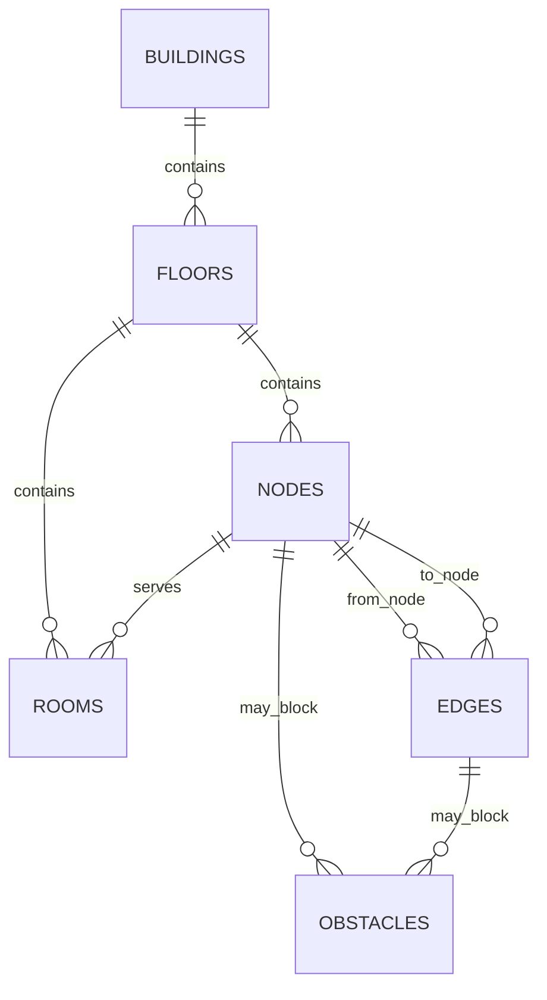

# Indoor Navigation Database Contract

**Status:** Schema baseline 1.0  
**Database:** PostgreSQL (use the version pinned in `docker-compose.yml`)  
**Migration tool:** Flyway  
**Canonical scope:** This document defines the initial relational model for `buildings`, `floors`, `rooms`, `nodes`, `edges`, and `obstacles`.

## 1. Design rules

1. Use plural `snake_case` table names and `snake_case` columns.
2. Use `BIGINT GENERATED BY DEFAULT AS IDENTITY` primary keys consistently for all six tables. IDs are exposed as positive JSON integers in the API contract.
3. Use explicit foreign keys, `NOT NULL` constraints where appropriate, and database checks for invalid relationships and persisted distances.
4. Keep cross-floor connector types on `edges`; do not create a separate `connectors` table in the initial schema.
5. An obstacle targets exactly one node or edge. Clearing an obstacle is a state change (`active = false`, set `cleared_at`), not a physical delete.
6. Database migrations are append-only after merge. Use `V<n>__<description>.sql`; never edit an already-applied migration.
7. JPA schema generation must not be used to create/update shared schemas. Use Flyway migrations and configure Hibernate schema handling to `validate` outside throwaway tests.

## 2. Entity relationship overview



- A Building has many Floors.
- A Floor belongs to one Building and has Rooms and Nodes.
- A Room is a named destination linked to one navigable Node. Multiple room records may link to a shared node if the real floor plan requires it.
- An Edge connects two Nodes and carries the traversal cost, accessibility flag, directionality, and optional connector type.
- An Obstacle blocks one Node or one Edge. The `building_id` on an obstacle scopes queries and is checked against the target's building through application validation; a database trigger is not required in the initial baseline.

## 3. Tables

### 3.1 `buildings`

| Column | Type | Null? | Rules / meaning |
|---|---|---:|---|
| `id` | `BIGINT` identity | No | Primary key |
| `name` | `VARCHAR(200)` | No | Display name; must not be blank |
| `address` | `TEXT` | Yes | Optional address or location description |
| `description` | `TEXT` | Yes | Optional descriptive text |
| `created_at` | `TIMESTAMPTZ` | No | Defaults to current timestamp |
| `updated_at` | `TIMESTAMPTZ` | No | Defaults to current timestamp; update on write in application |

Index: primary key on `id`.

### 3.2 `floors`

| Column | Type | Null? | Rules / meaning |
|---|---|---:|---|
| `id` | `BIGINT` identity | No | Primary key |
| `building_id` | `BIGINT` | No | FK to `buildings.id`, `ON DELETE CASCADE` |
| `level` | `INTEGER` | No | Numeric level; negative values may represent basements |
| `label` | `VARCHAR(120)` | No | Display label; must not be blank |
| `map_asset_url` | `TEXT` | Yes | Optional reference to a floor-plan asset |
| `created_at` | `TIMESTAMPTZ` | No | Defaults to current timestamp |
| `updated_at` | `TIMESTAMPTZ` | No | Defaults to current timestamp; update on write in application |

Constraints and indexes:
- `UNIQUE (building_id, level)`.
- Index on `building_id`.

### 3.3 `nodes`

| Column | Type | Null? | Rules / meaning |
|---|---|---:|---|
| `id` | `BIGINT` identity | No | Primary key |
| `floor_id` | `BIGINT` | No | FK to `floors.id`, `ON DELETE CASCADE` |
| `x` | `DOUBLE PRECISION` | No | X coordinate in that floor's coordinate system |
| `y` | `DOUBLE PRECISION` | No | Y coordinate in that floor's coordinate system |
| `type` | `VARCHAR(32)` | No | `ROOM_ENTRANCE`, `CORRIDOR`, `DOOR`, `LANDING`, or `LANDMARK` |
| `created_at` | `TIMESTAMPTZ` | No | Defaults to current timestamp |
| `updated_at` | `TIMESTAMPTZ` | No | Defaults to current timestamp; update on write in application |

Constraints and indexes:
- `CHECK (type IN ('ROOM_ENTRANCE', 'CORRIDOR', 'DOOR', 'LANDING', 'LANDMARK'))`.
- Index on `floor_id`.
- Coordinate origin and map-unit scaling must be consistent within a floor. Do not assume coordinates must be non-negative; the origin convention is a map-data decision.

### 3.4 `rooms`

| Column | Type | Null? | Rules / meaning |
|---|---|---:|---|
| `id` | `BIGINT` identity | No | Primary key |
| `floor_id` | `BIGINT` | No | FK to `floors.id`, `ON DELETE CASCADE` |
| `node_id` | `BIGINT` | No | FK to `nodes.id`, `ON DELETE RESTRICT` |
| `name` | `VARCHAR(200)` | No | Room/place display name; must not be blank |
| `number` | `VARCHAR(80)` | Yes | Room number/code |
| `category` | `VARCHAR(120)` | Yes | Optional category such as Office or Lab |
| `map_x` | `DOUBLE PRECISION` | Yes | Optional label/map position X |
| `map_y` | `DOUBLE PRECISION` | Yes | Optional label/map position Y |
| `created_at` | `TIMESTAMPTZ` | No | Defaults to current timestamp |
| `updated_at` | `TIMESTAMPTZ` | No | Defaults to current timestamp; update on write in application |

Constraints and indexes:
- The room's `floor_id` must match the floor of its linked `node_id`; validate this in the service layer in the initial schema.
- Index on `floor_id` and `node_id`.
- Add a search index suitable for case-insensitive lookup over `name` and `number` when implementing room search. The initial portable baseline may use B-tree indexes; use PostgreSQL-specific trigram/full-text indexes only if adopted and documented by migration.

### 3.5 `edges`

| Column | Type | Null? | Rules / meaning |
|---|---|---:|---|
| `id` | `BIGINT` identity | No | Primary key |
| `from_node_id` | `BIGINT` | No | FK to `nodes.id`, `ON DELETE CASCADE` |
| `to_node_id` | `BIGINT` | No | FK to `nodes.id`, `ON DELETE CASCADE` |
| `distance_meters` | `DOUBLE PRECISION` | No | Positive traversal cost/distance in metres |
| `accessible` | `BOOLEAN` | No | Whether this edge is eligible for accessible-only routing |
| `bidirectional` | `BOOLEAN` | No | Whether the edge can be traversed in both directions |
| `connector_type` | `VARCHAR(16)` | Yes | `STAIRS`, `ELEVATOR`, `RAMP`, or `NULL` for ordinary edges |
| `created_at` | `TIMESTAMPTZ` | No | Defaults to current timestamp |
| `updated_at` | `TIMESTAMPTZ` | No | Defaults to current timestamp; update on write in application |

Constraints and indexes:
- `CHECK (from_node_id <> to_node_id)`; graph-engine tests may still exercise zero-length-weight edges independently of persisted schema.
- `CHECK (distance_meters > 0)`.
- `CHECK (connector_type IS NULL OR connector_type IN ('STAIRS', 'ELEVATOR', 'RAMP'))`.
- Index on `from_node_id` and `to_node_id`.
- The connector is represented by an edge connecting nodes on different floors. For non-connector edges, both endpoint nodes must be on the same floor. Validate endpoint floor consistency in the service/import validation layer for the initial schema.
- If an edge is bidirectional, the engine may traverse it both ways. For a one-way edge, traversal is from `from_node_id` to `to_node_id` only.
- Duplicate-edge policy is controlled by graph import/service validation; the initial schema does not impose a uniqueness constraint on node pairs.

### 3.6 `obstacles`

| Column | Type | Null? | Rules / meaning |
|---|---|---:|---|
| `id` | `BIGINT` identity | No | Primary key |
| `building_id` | `BIGINT` | No | FK to `buildings.id`, `ON DELETE CASCADE` |
| `node_id` | `BIGINT` | Yes | FK to `nodes.id`, `ON DELETE CASCADE` |
| `edge_id` | `BIGINT` | Yes | FK to `edges.id`, `ON DELETE CASCADE` |
| `reason` | `TEXT` | No | Human-readable reason; must not be blank |
| `active` | `BOOLEAN` | No | Defaults to `TRUE` |
| `created_at` | `TIMESTAMPTZ` | No | Defaults to current timestamp |
| `cleared_at` | `TIMESTAMPTZ` | Yes | Null while active; set when cleared |

Constraints and indexes:
- Exactly one target must be set: `CHECK ((node_id IS NOT NULL AND edge_id IS NULL) OR (node_id IS NULL AND edge_id IS NOT NULL))`.
- `CHECK ((active = TRUE AND cleared_at IS NULL) OR (active = FALSE AND cleared_at IS NOT NULL))`.
- Index on `building_id`; indexes on `node_id` and `edge_id`.
- The referenced target must belong to `building_id`; validate this in the obstacle service in the initial schema.
- The list API returns active obstacles only. `DELETE /api/v1/obstacles/{obstacleId}` clears the record by setting `active = FALSE` and `cleared_at`, rather than deleting it.

## 4. Cross-cutting integrity and delete behavior

- Deleting a Building cascades to its Floors and Obstacles. Floors cascade to their Rooms and Nodes. Nodes/Edges referenced by active obstacles should not normally be deleted independently; the explicit cascade behavior above prevents orphaned obstacles, while all structural changes must invalidate the building graph cache.
- A Room's `floor_id` must agree with the floor of its `node_id`.
- Both endpoint nodes of an ordinary Edge must be on the same floor. A connector Edge must connect different floors and have a non-null `connector_type`.
- An Obstacle's target must belong to the same building recorded on the obstacle.
- The initial baseline uses service/import validation for cross-row invariants. If future data imports or direct SQL writes need stronger guarantees, add database triggers or composite foreign keys in a versioned migration and update this document.

## 5. Routing and accessibility semantics

- The backend loads a building's Nodes, Edges and active Obstacles to construct the graph passed to the pure-Java routing engine.
- An active obstacle on a Node prevents a route from using that node; an active obstacle on an Edge prevents traversing that edge.
- With `accessibleOnly = true`, exclude edges with `accessible = false` and exclude `STAIRS` connector edges. Elevators and ramps may be used when their edges are marked accessible.
- Connector types are stored on `edges.connector_type`: `STAIRS`, `ELEVATOR`, and `RAMP`. No separate connector table is part of the initial schema.
- Any node, edge or obstacle write invalidates the cached graph for the affected building.

## 6. Index summary

At minimum, provide indexes for:

- Every primary key (provided by PostgreSQL primary-key constraints).
- `floors(building_id)` and unique `(building_id, level)`.
- `nodes(floor_id)`.
- `rooms(floor_id)`, `rooms(node_id)`, and the room-search fields `name` / `number`.
- `edges(from_node_id)` and `edges(to_node_id)`.
- `obstacles(building_id)`, `obstacles(node_id)`, and `obstacles(edge_id)`.

Avoid adding speculative indexes without checking actual query plans. Search indexes can be introduced in a later migration once the chosen matching behavior and seed-data size are known.

## 7. Flyway migrations and seed data

Recommended initial layout:

```text
database/
├── migrations/
│   ├── V1__init_schema.sql
│   ├── V2__seed_sample_building.sql
│   └── V3__add_room_search_indexes.sql
└── seed/
    └── README.md
```

The file names above illustrate the convention; only create migrations for changes actually implemented.

Migration rules:
1. Name files `V<n>__<description>.sql` and keep version numbers unique and increasing.
2. Each migration must run on an empty database and after all previous migrations.
3. Never modify a migration after it has been merged/applied; add a new migration for corrections.
4. Use transactions where supported by PostgreSQL and Flyway. Avoid embedding environment-specific secrets or URLs.
5. Seed data should include at least one building and two floors; stairs and elevator connector edges; an accessible and a non-accessible path; and an active obstacle. This seed must exercise single-floor, multi-floor, accessibility-filtered, blocked-path and no-route scenarios.
6. Backend schema validation uses Hibernate `ddl-auto=validate`, not `create` or `update` in shared environments.
7. Update this document in the same pull request as every schema/migration change and notify the backend owner.

## 8. Open implementation notes

The project contract fixes the entity relationships, table names, core columns, connector representation and obstacle lifecycle. The following remain implementation choices that must be kept consistent in migrations and code:

- Whether to add PostgreSQL trigram/full-text search indexes for room search after measuring query needs.
- The exact floor-plan coordinate origin, scale and conversion from stored coordinates to displayed pixels.
- Whether to strengthen cross-row consistency rules with triggers/composite foreign keys rather than service/import validation.
- The exact seed building and its real-world floor-plan geometry.
